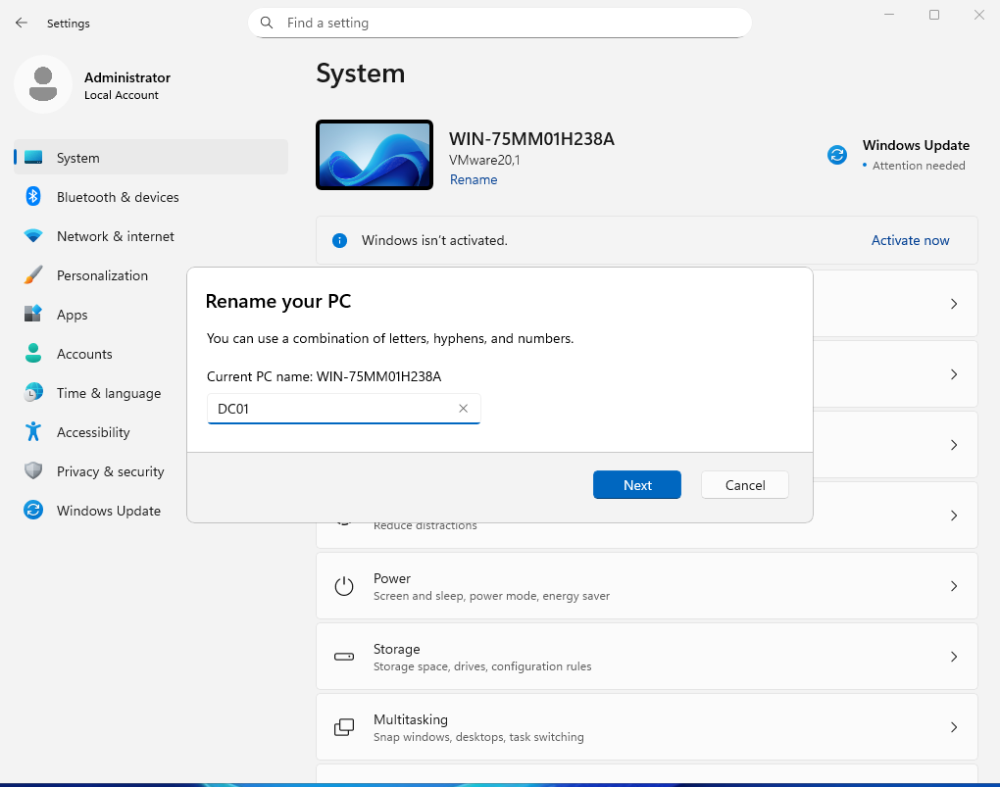
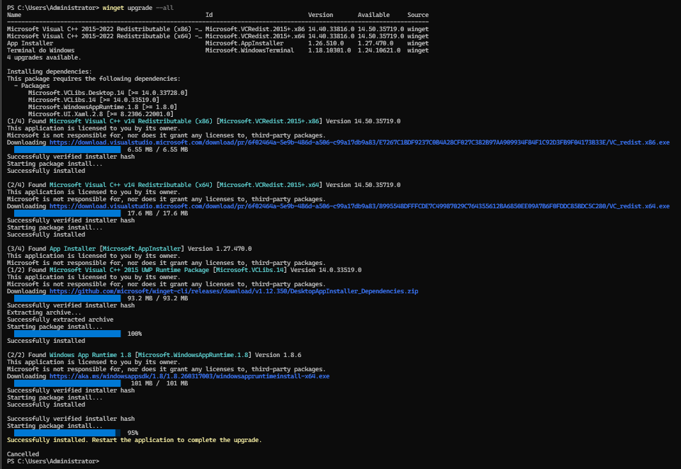
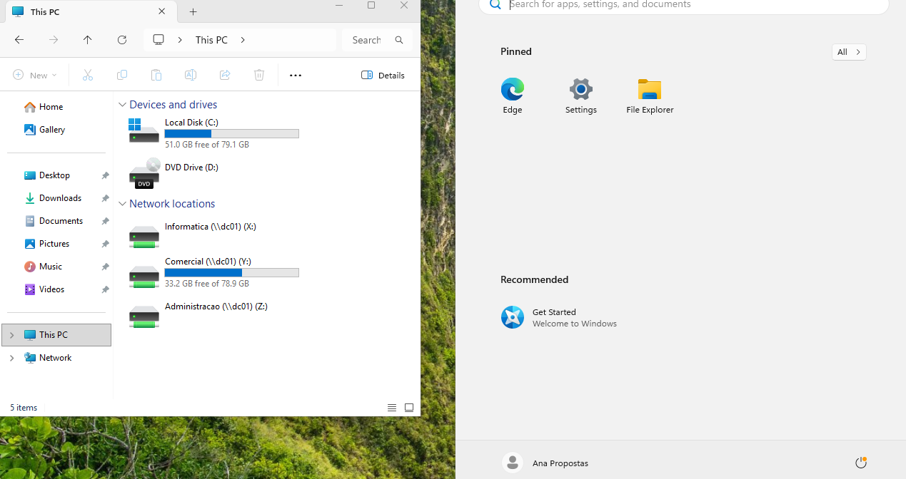
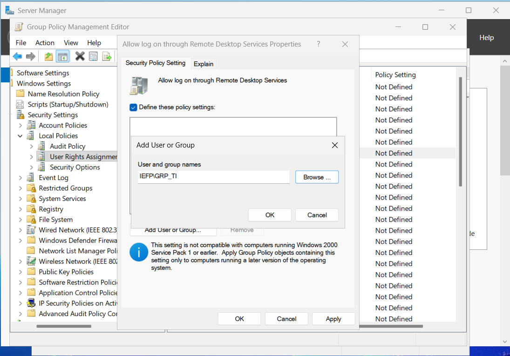
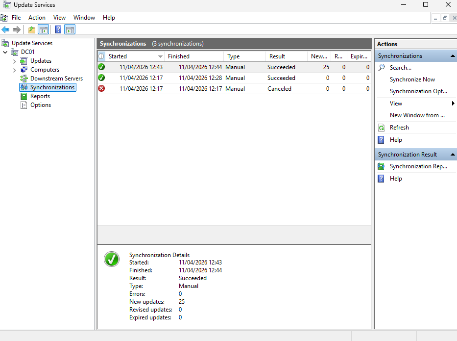
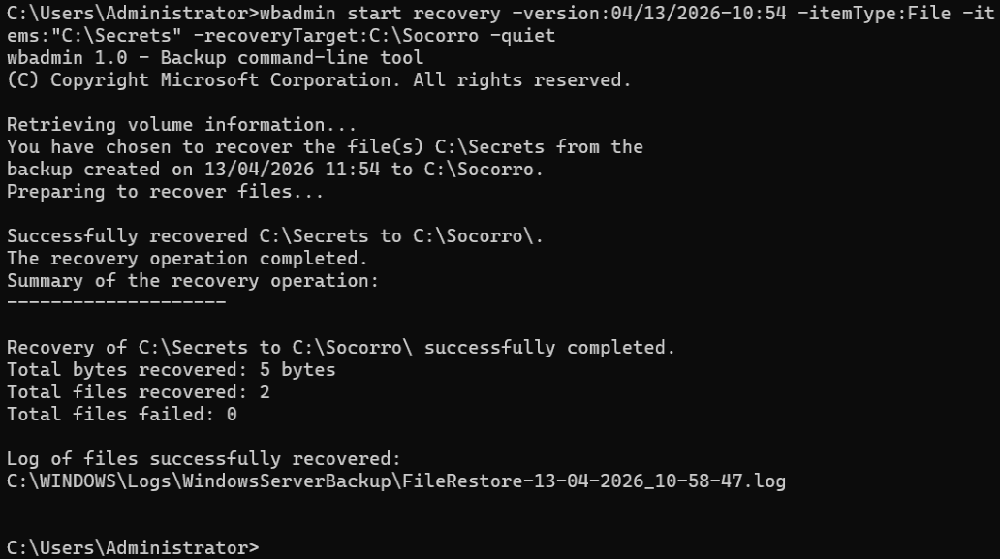
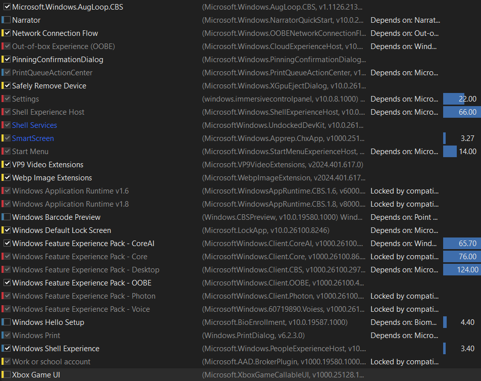
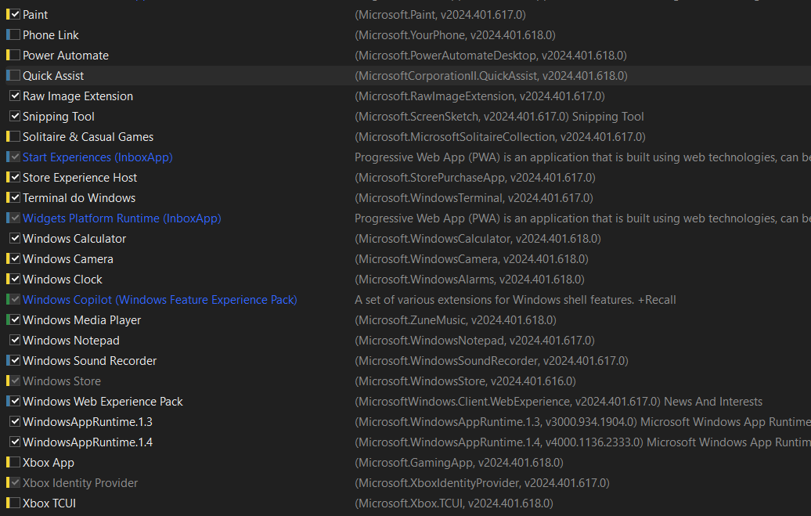
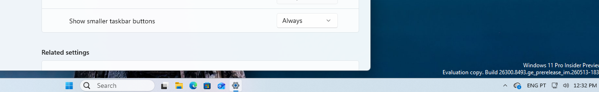
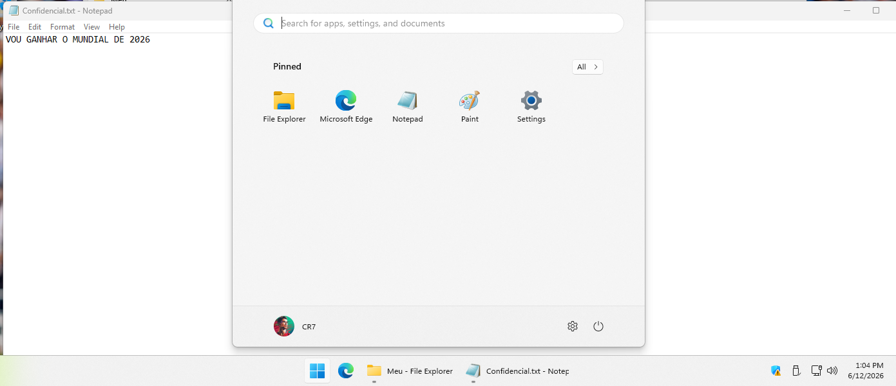

# Windows Server

**Responsável técnica:** Alexandra Carneiro (Técnica de Redes e Segurança)

Um servidor Windows Server 2025 a funcionar como Domain Controller de um domínio Active Directory, com gestão de utilizadores e grupos, partilhas de ficheiros por departamento, perfis móveis, acesso remoto (RDS), atualizações centralizadas (WSUS) e backups agendados e manuais. Inclui ainda personalização de imagens Windows com NTLite, funcionalidades experimentais do Windows Insider e recuperação de arranque em quatro cenários de falha.

Ambiente de laboratório numa máquina virtual VMware.

## Ambiente

| Item | Valor |
| --- | --- |
| Hipervisor | VMware Workstation |
| Sistema operativo | Windows Server 2025 Standard, versão 24H2 (build 26100.32522) |
| Servidor | DC01 (renomeado de WIN-75MM01H238A) |
| IP | 192.168.80.100/24 (estático) |
| Gateway | 192.168.80.1 |
| DNS | 192.168.80.100 (o próprio servidor) |
| Domínio | iefp.internal |
| Roles | Active Directory Domain Services, DNS Server, File and Storage Services, Remote Desktop Services, WSUS |

## Domain Controller

- IP estático 192.168.80.100, gateway 192.168.80.1 e DNS próprio (192.168.80.100). Um Domain Controller não pode depender de DHCP, porque ele próprio é a referência de DNS da rede.
- Servidor renomeado de WIN-75MM01H238A para DC01.

*Renome do servidor de WIN-75MM01H238A para DC01.*
- Role Active Directory Domain Services instalado; domínio iefp.internal criado.
- Preparação da VM: VMware Tools instalado, Windows atualizado, 4 pacotes atualizados com `winget upgrade --all` (Visual C++ 2015-2022 Redistributable x86 e x64, App Installer e Windows Terminal) e snapshot "CLEAN STATE" criado no VMware antes das configurações seguintes.

*Atualização dos pacotes com `winget upgrade --all`: Visual C++ 2015-2022 (x86 e x64), App Installer e Windows Terminal.*

## Active Directory: OUs, grupos e utilizadores

Três unidades organizacionais (OUs), uma por departamento, cada uma com o seu grupo de segurança (âmbito Global):

| OU | Grupo | Utilizadores |
| --- | --- | --- |
| Administração | GRP_Administracao | Bruno Boss |
| Comercial | GRP_Comercial | Joao Negocios, Ana Propostas, Jose Descontos, Andre Clientes |
| Informática | GRP_TI | Nelson Debug, Guilherme Reboot, Diogo Script, Alexandra Root |

- Padrão de logon `nome.apelido` (por exemplo, `nelson.debug`), com a opção "User must change password at next logon" ativa.
- Cada utilizador foi associado ao grupo do seu departamento.
- Um cliente Windows 11 foi integrado no domínio iefp.internal, com autenticação centralizada.

Os nomes dos utilizadores são nomes de teste de laboratório.

## Perfis móveis (roaming profiles)

- Pasta `C:\Perfis` criada no servidor e partilhada para Authenticated Users.
- Profile Path configurado no AD: `\\dc01\perfis\%username%`.
- Verificação: a criação da pasta `alexandra.root.V6` no servidor confirma que o perfil acompanhou o utilizador.
- Se o servidor do perfil ficar indisponível, o utilizador entra com a cópia local em cache; num computador novo onde nunca entrou, pode receber um perfil temporário.

## Partilhas de ficheiros por departamento

Pastas criadas em `C:\Partilhas`: `Administracao`, `Comercial` e `Informatica`.

| Pasta | Permissão de partilha | Permissão NTFS |
| --- | --- | --- |
| Administracao | Authenticated Users, Full Control | GRP_Administracao com Modify |
| Comercial | Authenticated Users, Full Control | GRP_Comercial com Modify |
| Informatica | Authenticated Users, Full Control | GRP_TI com Modify |

A restrição por departamento é feita ao nível NTFS: ao nível da partilha, Authenticated Users tem Full Control nas três pastas; é o NTFS que limita cada grupo à sua pasta (Modify, sem Full Control).

Testes de acesso: um utilizador de cada grupo acedeu à pasta do seu departamento e criou lá um ficheiro de teste (Teste GRP_TI, Teste GRP_Comercial, Teste GRP_Administracao).

Drives mapeadas em todas as sessões: X: Informatica, Y: Comercial, Z: Administracao (`\\dc01`).

*Drives mapeadas: X: Informatica, Y: Comercial e Z: Administracao (\\dc01).*

## Acesso remoto (RDS)

- Role Remote Desktop Services instalado no DC01, com as ferramentas de licenciamento RDS.
- Grupo GRP_TI autorizado na política "Allow log on through Remote Desktop Services" e adicionado ao grupo Remote Desktop Users.

*Política "Allow log on through Remote Desktop Services" com o grupo GRP_TI autorizado.*
- Políticas aplicadas com `gpupdate /force`.
- Validação: ligação RDP a 192.168.80.100 com credenciais de domínio, com duas sessões ativas em simultâneo no Task Manager (Administrator e nelson.debug).

## Atualizações centralizadas (WSUS)

- Windows Server Update Services configurado no DC01.
- Classificações sincronizadas: apenas Critical Updates, Definition Updates e Security Updates.
- Sincronização automática diária às 03:00.
- Uma sincronização manual concluída com 25 novas atualizações.

*Consola WSUS: sincronizações manuais, uma delas com 25 novas atualizações.*

## Backups

- Volume C: reduzido em 10.000 MB no Disk Management.
- Novo volume "Backups Agendados (M:)", 9,76 GB, NTFS com compressão de ficheiros.
- Backup agendado: diário às 03:00, VSS Copy Backup, da pasta `C:\Administrator` para o volume M:.
- Backup urgente manual: pasta `C:\ProgramData` para o volume "Backups Urgentes (U:)".
- Restauro de validação: dados restaurados para a localização alternativa `C:\Urgente`.
- Backup e restauro por linha de comandos com wbadmin: `wbadmin start backup -backupTarget:U: -include:"C:\Secrets" -quiet` e `wbadmin get versions` (duas versões listadas, 13/04/2026 às 11:40 e 11:54). Restauro de `C:\Secrets` para `C:\Socorro` concluído.

*Restauro por wbadmin: "Successfully recovered C:\Secrets to C:\Socorro", 2 ficheiros recuperados, 0 com falha.*

## Personalização de imagens Windows com NTLite

### Imagem pessoal

- Limpeza do Windows 11 através da remoção de componentes não essenciais: aplicações nativas (bloatware) como jogos, serviços Xbox e ferramentas de entretenimento.
- Privacidade e segurança: telemetria configurada para o nível mínimo ('Security') e bloqueio do acesso de aplicações a dados sensíveis como histórico de chamadas, contactos e localização.
- 28 ajustes de configuração: Modo Escuro em todo o sistema, Menu de Contexto Clássico (botão direito antigo) e exibição automática de ícones essenciais no ambiente de trabalho ('Este PC' e 'Reciclagem').
- Imagem ISO gerada: 'Win11PROCustom', com todas as modificações, instalada e validada numa máquina virtual (menu inicial limpo, ícones personalizados no ambiente de trabalho, tema escuro e menu clássico).

*Lista de componentes no NTLite, com a seleção do que manter e do que remover.*

### Imagem em contexto empresarial

- A mesma base, adaptada a um contexto empresarial.
- Aplicações visíveis no sistema instalado: 7-Zip e Firefox.
- Power settings configurados.
- Verificação do owner no winver.

*Lista de componentes no NTLite em contexto empresarial.*

## Windows Insider: funcionalidades experimentais

- Windows 11 Pro Insider Preview (evaluation copy).
- Funcionalidades experimentais (flags) ativadas e validadas:
  - Barra de tarefas no topo do ecrã (posições alternativas da barra de tarefas).
  - Barra de tarefas em formato pequeno ("Show smaller taskbar buttons — Always").
  - Novo Run dialog moderno (Win+R).
  - Indicadores de progresso uniformes nos cenários principais do Windows.

*Barra de tarefas em formato pequeno no Windows 11 Pro Insider Preview (evaluation copy).*

## Recuperação de arranque do Windows

Quatro cenários de falha de arranque, cada um com erro observado, diagnóstico, solução aplicada e resultado final. Em todos os casos, o arranque foi recuperado com login confirmado e dados do utilizador preservados.

### Caso 1 — BCD corrompido

- Erro: o sistema não chega a iniciar o Windows; entra em loop de recuperação automática, com ecrã preto "Please wait" seguido do ecrã azul "Choose your keyboard layout", sem código de erro explícito (redirecionado para o WinRE).
- Diagnóstico (Windows PE): `diskpart` e `list volume` — a partição do Windows (Volume 1, 79 GB) e a partição de sistema UEFI (Volume 2, 100 MB) estão operacionais, mas sem letras atribuídas. Causa: Dados de Configuração de Arranque (BCD) corrompidos ou ausentes, impedindo o gestor de boot de localizar o sistema operativo.
- Solução (Windows PE): atribuir letras temporárias às partições e recriar o BCD:
  - `select volume 1` e `assign letter=W:` (partição do Windows)
  - `select volume 2` e `assign letter=S:` (partição EFI)
  - `bcdboot W:\Windows /s S: /f UEFI` (recria o BCD na partição EFI para arranque UEFI)
- Resultado: arranque com sucesso, login na conta local confirmado e dados do utilizador preservados.

### Caso 2 — winload.efi apagado

- Erro: loop de reparação automática, ecrã azul "Automatic Repair couldn't repair your PC", sem código numérico; aponta para o ficheiro de log `C:\Recovery\WindowsRE\Winre.wim\System32\Logfiles\Srt\SrtTrail.txt`.
- Diagnóstico: `diskpart` e `list volume` — o disco do Windows aparece com a letra E (não C, como o ecrã indicava); ao tentar abrir o caminho exato no Bloco de Notas, o ficheiro não existe. Hipótese: o erro ocorre numa fase tão inicial que o Windows nem chega a escrever o relatório; o ficheiro essencial de arranque (winload.efi) foi apagado ou corrompido.
- Solução (Windows PE): `sfc /scannow /offbootdir=E:\ /offwindir=E:\Windows` — o Verificador de Ficheiros de Sistema em modo offline deteta a ausência do carregador de arranque e repõe a cópia saudável do winload.efi.
- Resultado: arranque com sucesso, login confirmado e dados preservados.

### Caso 3 — Driver de disco desativado

- Erro: "Your device ran into a problem and needs to restart." Stop code: INACCESSIBLE_BOOT_DEVICE (0x7B).
- Diagnóstico: `diskpart` — o volume do sistema (79 GB) está saudável, com a letra E. Disco saudável mas boot inacessível: hipótese de o registo offline ter sido alterado, com o driver de armazenamento NVMe (stornvme) com o valor de arranque em 4 (Desativado), fazendo o Windows perder a comunicação com o disco durante o arranque.
- Solução (Windows PE): carregar o registo offline, corrigir o driver e guardar:
  - `reg load` (carrega o hive SYSTEM offline para uma chave temporária)
  - `reg add` (repõe o parâmetro Start do stornvme em 0, "Ativado no Arranque")
  - `reg unload` (descarrega e guarda as alterações no disco)
- Resultado: arranque com sucesso, login confirmado e dados preservados.

### Caso 4 — Ficheiros essenciais em falta (ntoskrnl.exe)

- Erro: ecrã azul de recuperação, kernel em falta ou com erros. File: `\WINDOWS\system32\ntoskrnl.exe`, Error code: 0xc000000f. A tecla F1 para a recuperação local não funciona (a máquina reinicia para o mesmo ecrã).
- Diagnóstico: como a recuperação local estava corrompida, arranque por uma ISO externa do Windows PE (CD/DVD) no VMware. `diskpart` — os volumes do disco estão sem letras (por arrancar do CD); o volume principal (79 GB) é o Volume 1. Hipótese: o ficheiro do kernel (ntoskrnl.exe) foi apagado e o acesso à recuperação local quebrado.
- Solução (Windows PE): criar uma pasta de trabalho e correr o verificador offline:
  - `md E:\Scratch` (o WinPE corre de uma ISO só de leitura, e o sfc precisa de espaço em disco para descompactar os ficheiros)
  - `sfc /scannow` (modo offline, usa E:\Scratch e repõe o ntoskrnl.exe saudável em System32)
- Resultado: arranque com sucesso, login confirmado e dados preservados.

*Menu inicial limpo e ficheiro de teste intacto após a recuperação de arranque, confirmando que os dados foram preservados.*

## Relatório final

O relatório final do trabalho descreve a infraestrutura no contexto de uma empresa fictícia (PixelForge Studios, domínio pixelforge.internal, departamentos Programação, Arte e Produção). Está no repositório como `Avaliacao-Relatorio-final.pdf`.

## Ficheiros

- `1-Preparacao-da-VM.pdf` - VMware Tools, atualizações, winget e snapshot
- `2-Domain-Controller.pdf` - IP estático, renome do servidor e AD DS
- `3-Active-Directory.pdf` - OUs, grupos, utilizadores e junção ao domínio
- `3b-Perfis-moveis.pdf` - roaming profiles
- `4-Partilhas-de-ficheiros.pdf` - partilhas, permissões e mapeamento
- `5-Acesso-remoto-RDS.pdf` - Remote Desktop Services
- `5b-WSUS.pdf` - Windows Server Update Services
- `6-Backups.pdf` - volume de backups, backup agendado e wbadmin
- `7-NTLite-pessoal.pdf` - imagem Windows 11 personalizada com NTLite (bloatware, telemetria, 28 ajustes, ISO Win11PROCustom)
- `8-NTLite-empresa.pdf` - imagem NTLite em contexto empresarial (7-Zip, Firefox, power settings, winver)
- `9-Windows-Insider.pdf` - funcionalidades experimentais do Windows Insider (barra de tarefas no topo e pequena, novo Run dialog)
- `10-Recuperacao-arranque.pdf` - recuperação de arranque em 4 cenários (BCD, winload.efi, driver NVMe, ntoskrnl.exe)
- `Avaliacao-Relatorio-final.pdf` - relatório final

## Notas

- Ambiente de laboratório. Os nomes dos utilizadores e dos departamentos são de teste.
- O domínio documentado nos ficheiros é iefp.internal; o relatório final usa o domínio pixelforge.internal no contexto da empresa fictícia.

---

## 👩‍💻 Autoria

**Alexandra Carneiro**  
*Graduanda em Engenharia de Software | Técnica Especialista em Cibersegurança & Redes*

- **GitHub:** [@alexandra-carneiro](https://github.com/alexandra-carneiro)  
- **LinkedIn:** [carneiro-alexandra](https://www.linkedin.com/in/carneiro-alexandra/)  
- **Portfólio:** [alexandracarneiro.tech](https://alexandracarneiro.tech/)
